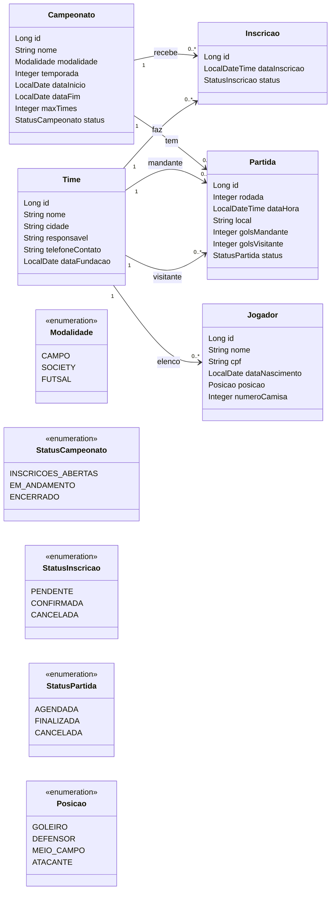

# Várzea API: gestão de campeonatos amadores

Projeto Final de Back-end (API REST), SATC, 2026/2.

API REST para organizar campeonatos amadores de futebol: inscrição de times,
elenco de jogadores, tabela de partidas e resultados.

> **Status:** E1 (19/11). Este README traz tema, equipe, problema, domínio e o
> UML inicial. As próximas entregas vão acrescentar o código, as instruções de
> execução e a documentação completa.

---

## Tema

**Esportes e Atividades Físicas.** A aplicação é um sistema de gestão de
campeonatos amadores (futebol de várzea, society e futsal de bairro).

## Integrantes

| Integrante | Papel (proposta inicial) |
|---|---|
| Kauã Guollo Mazon | Persistência: entidades JPA, mapeamentos, migrations e repositórios |
| Lucas Fernandes Rovaris | Regras de negócio: services, validações e tratamento de erros |
| Vitor Fernandes de Almeida | Camada web: controllers, DTOs, paginação, filtros e ordenação |
| Bruno | Qualidade e documentação: testes, OpenAPI/Swagger, README e evidências |

Os papéis indicam quem lidera cada parte. Todos os integrantes vão commitar em
todas as camadas.

## Problema

Campeonatos amadores costumam ser organizados por grupos de WhatsApp e
planilhas. Os problemas mais comuns são:

- **Inscrições sem controle:** um jogador aparece em dois times do mesmo
  campeonato e ninguém percebe antes do jogo.
- **Tabela feita na mão:** o organizador lança placares numa planilha e erra a
  pontuação, o saldo de gols ou a ordem da classificação.
- **Informação espalhada:** datas, locais e resultados ficam perdidos em
  mensagens, e os times não têm um lugar único para consultar.

A Várzea API centraliza esses dados e aplica as regras do campeonato no
servidor. Assim, qualquer cliente HTTP (site, app ou bot) consulta a mesma
informação, já validada.

## Domínio

O domínio tem cinco conceitos:

- **Campeonato:** uma competição com nome, modalidade, temporada, datas e
  status. O status passa por `INSCRICOES_ABERTAS`, `EM_ANDAMENTO` e
  `ENCERRADO`.
- **Time:** uma equipe amadora com nome, cidade e responsável. Um time pode
  disputar vários campeonatos.
- **Jogador:** uma pessoa que pertence a um time, com CPF, data de nascimento,
  posição e número da camisa.
- **Inscrição:** a participação de um time num campeonato. Liga Campeonato e
  Time (N:N) e guarda a data e a situação da inscrição.
- **Partida:** um jogo entre dois times inscritos no mesmo campeonato, com
  rodada, data, local, placar e status.

### Regras de negócio iniciais

1. Nome de time e CPF de jogador são únicos. Uma duplicata retorna `409 Conflict`.
2. Um jogador pertence a um único time por vez.
3. Um time só se inscreve em campeonato com status `INSCRICOES_ABERTAS` e não
   passa do limite de times (`maxTimes`).
4. Uma partida só envolve times inscritos no campeonato dela, e o mandante tem
   que ser diferente do visitante.
5. O placar só é lançado em partida `AGENDADA`, que passa a `FINALIZADA`. Gols
   não podem ser negativos.
6. Não se exclui um time que tenha partidas registradas, para não perder o
   histórico. Nesse caso a API retorna `409 Conflict`.

## UML inicial das entidades

### Relacionamentos

| Relação | Cardinalidade | Como fica no banco |
|---|---|---|
| Time → Jogador | 1:N | `jogador.time_id` (FK) |
| Campeonato ↔ Time | N:N | tabela `inscricao` (`campeonato_id`, `time_id`, único por par) |
| Campeonato → Partida | 1:N | `partida.campeonato_id` (FK) |
| Time → Partida (mandante/visitante) | 1:N (duas vezes) | `partida.mandante_id` e `partida.visitante_id` (FKs) |

## Tecnologias planejadas

| Camada | Tecnologia |
|---|---|
| Linguagem | Java 21 |
| Framework | Spring Boot 3 (Spring Web, Spring Data JPA, Bean Validation) |
| Banco de dados | PostgreSQL |
| Migrations | Flyway |
| Build | Maven |
| Documentação da API | springdoc-openapi (Swagger UI) |
| Testes | JUnit 5, Mockito e Spring Boot Test |

A API seguirá a arquitetura em camadas **Controller → Service → Repository**,
com DTOs de entrada e saída separados das entidades.

## Endpoints previstos

| Recurso | Rotas |
|---|---|
| Campeonatos | `GET/POST /campeonatos`, `GET/PUT/DELETE /campeonatos/{id}` |
| Times | `GET/POST /times`, `GET/PUT/DELETE /times/{id}` |
| Jogadores | `GET/POST /jogadores`, `GET/PUT/DELETE /jogadores/{id}` |
| Inscrições | `GET/POST /campeonatos/{id}/inscricoes`, `GET/PUT/DELETE /inscricoes/{id}` |
| Partidas | `GET/POST /partidas`, `GET/PUT/DELETE /partidas/{id}` |

Toda listagem (`GET` sem id) terá paginação (`page`, `size`) e ordenação
(`sort`). Exemplos de filtros previstos:

- `GET /jogadores?timeId=3&posicao=ATACANTE&sort=nome,asc`
- `GET /partidas?campeonatoId=1&rodada=2&status=FINALIZADA`
- `GET /campeonatos?status=INSCRICOES_ABERTAS&modalidade=SOCIETY&page=0&size=10`

## Entregas

| Entrega | Data | Conteúdo |
|---|---|---|
| E1 | 19/11 | Repositório, tema, integrantes, problema, domínio e UML inicial |
| E2 | 26/11 | API base com CRUD e requisitos obrigatórios |
| E3 | 03/12 | Carta-desafio integrada por PR, extras, documentação final e slides |
